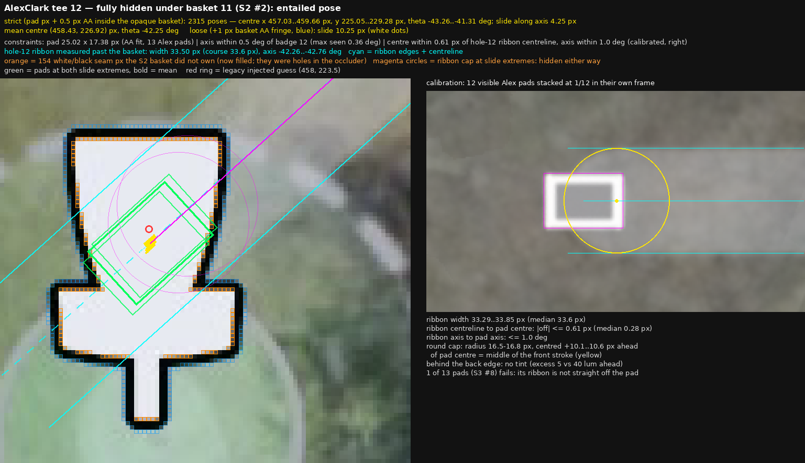
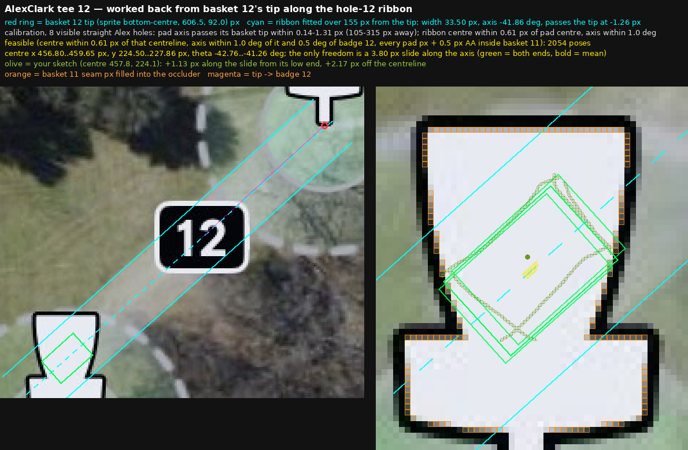

# AlexClark tee 12: entailed pose (fully hidden under basket 11)

Run from this folder: `python3 edges.py` (calibration), `python3 padstack.py`
(1/12 stack), `python3 render12.py` (feasible set + figure). Inputs are the
alex until-7 attempt `attempt-1792263349086-27173a1f38f5` and
`alex-pads.json` (AA render fit of the 13 visible pads, `scratchpad aafit/alexfit.py`).

## Calibrated on the 12 visible Alex pads with a straight start (13th: S3 #8)

| Quantity | Measured |
|---|---|
| ribbon width (50% edges, along-path averaged profile) | 33.29-33.85 px, median 33.6 px |
| ribbon centreline to pad centre | max 0.61 px, median 0.28 px |
| ribbon axis to pad axis | max 1.0 deg |
| ribbon start | round cap, radius 16.5-16.8 px, centred 10.1-10.6 px ahead of the pad centre (the middle of the front stroke); no tint behind the back edge |
| pad long axis to badge centre | median 0.23 deg, max 0.36 deg |

## AC12

- Hole-12 ribbon past the basket: width 33.50 px, axis -42.0..-42.8 deg (badge ray -42.76 deg).
- Strict (every pad pixel + 0.5 px AA inside the opaque basket, seam filled):
  centre x 457.03..459.66 px, y 225.05..229.28 px, theta -43.26..-41.31 deg;
  the only free direction is a 4.25 px slide along the axis.
- Loose (+1 px basket AA fringe): slide 10.25 px.
- The cap is hidden for every slide, so it adds no constraint here.
- S2 basket 2 left 154 white/black seam px unowned; they punched holes in the occluder until filled.

## Worked back from basket 12's tip (Sam, 2026-10-17)

- Tip = basket sprite bottom-centre (bbox x + 22.5 px, bbox y + 71 px).
- On the 8 visible straight Alex holes, the pad axis passes its basket's tip
  within 0.14-1.31 px, 105-315 px away (at most 0.43 deg). The bent holes
  miss by 16-120 px.
- The hole-12 ribbon, fitted over 155 px from basket 12's tip, is 33.50 px wide
  at -41.86 deg and passes the tip at -1.26 px.
- Feasible set: centre x 456.80..459.65 px, y 224.50..227.86 px,
  theta -42.76..-41.26 deg, a 3.80 px slide.
- Pinning the centreline exactly through the tip moves the box about
  0.8 px down; the slide stays 3.80 px.
- Sam's sketch (centre 457.8, 224.1 px) lies 1.13 px into the slide and
  2.17 px off the centreline.
