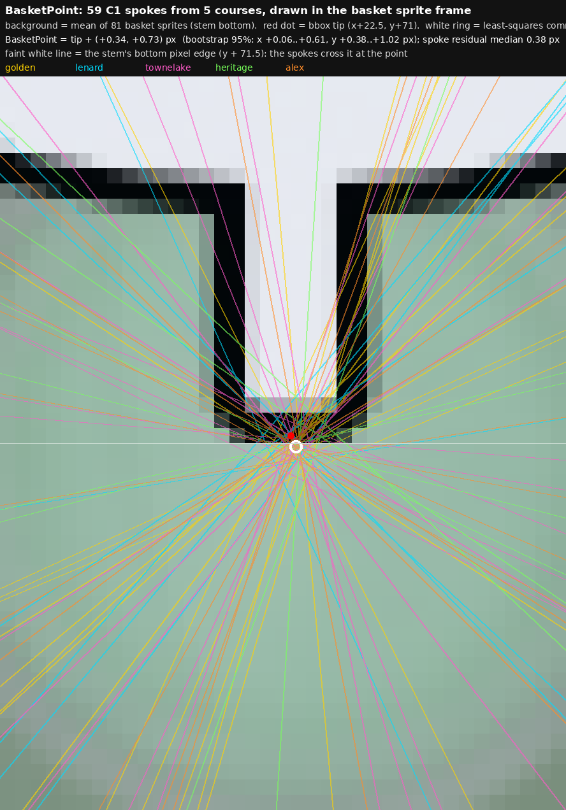

# BasketPoint: where the C1 spokes meet the basket stem

Sam (2026-10-17): "the spokes intersect with the basket tip edge at a
precise point. I bet THAT'S the precise BasketPoint."

- Each basket's C1 spoke is fitted as a free line (ridge points, PCA), with
  no centre assumed (`spokes.py`). The basket sprite is screen-constant
  (46 x 72 px on all courses), so every spoke should pass one point in the
  sprite frame. `solve.py` solves that point by least squares over 59
  spokes on 5 courses (outliers dropped at 3 MAD).
- **BasketPoint = (bbox x + 22.5, bbox y + 71) + (+0.34, +0.73) px.** That is
  the stem's bottom pixel edge (y + 71.5) at its centre.
  - Spoke residual: median 0.38 px, rms 0.81 px.
  - Bootstrap 95%: x +0.06..+0.61 px, y +0.38..+1.02 px.
  - Per course: golden (+0.23, +1.14), lenard (-0.57, +0.62),
    townelake (+0.38, +0.84), heritage (+1.48, +0.33),
    alex (+0.19, +0.85, residual 0.26 px).
- Cross-check against Sam's annotated basket points: median 0.88-1.09 px on
  lenard, townelake and heritage. Golden's annotations sit a mean 3.3 px above.

## Spokes as known structure (Sam: Data -> Structure -> Legibility; "spikes should be known + findable but are mostly only legible in easy cases")

- **Blind (data only):** `spokelabel.py` scans every angle for the brightest
  ridge, then names the basket by the tee it points at. It agrees with Sam
  on 26 of the 40 baskets it labels.
- **Structure:** basket n's spoke runs from its BasketPoint to the front edge
  of hole n+1's tee. `spoke_verify.py` reads ridge evidence only ALONG each
  predicted basket-to-tee line (+-2 deg), then one-to-one matching. It agrees
  with Sam on 42 of the 51 baskets it labels (golden 11/13, lenard 8/13,
  townelake 14/16, heritage 9/9). Median ridge on matched lines is
  7.7-14.7 lum; on unmatched lines -0.7 to -1.4 lum.
- **Legibility = independent structures agreeing.** The 3-point straight test
  also labels baskets (a straight hole n ends at basket n). Where the spoke
  and the straight test agree, Sam agrees 19/19. Where they disagree (11),
  exactly one is right:
  - the straight test, on truly straight holes (lenard 7, 10, 11, 13, 18;
    townelake 12, 14);
  - the spoke, on bent holes that line up by coincidence (golden 14, 15;
    townelake 16; heritage 9).
  
  A disagreement is precisely where to look, and the hallway settles it.
