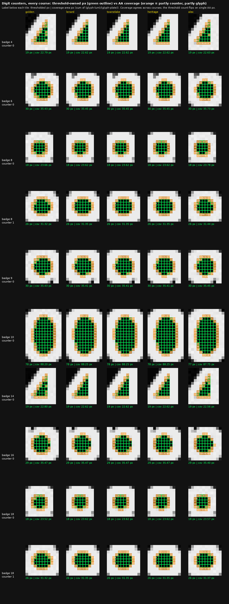

# Digit counters: assembly audit, all 5 courses

- Attribution is right everywhere: every badge ∪ mute ∪ digit-counter
  assembly is hole-free, and each counter is enclosed by exactly one digit.
  Counters are also in `mute.px` by design (`countersSubsetOfMute`).
- Thresholded counter px under-count the AA coverage area by 15-20%
  (4: 19 px vs 22.6 px; 0: 78 px vs 88.25 px).
- Coverage areas agree across courses to 0.04-0.30 px (0.50 px for alex "0").
  Lenard, Townelake and Heritage are identical to 0.01 px; golden and alex
  carry ±0.3 px noise.
- Alex "0" is 77 px instead of 78 px because one AA pixel reads lum 41
  there and lum 40 in golden: a threshold flip, not geometry.
- The "6" in badge 6 has 30 px and the "6" in 16 has 29 px: sub-pixel
  phase. Both cover 35.45 px.
- 6 and 9 counters have the same coverage (35.45 px vs 35.41 px). The 9 is
  the 6 glyph rotated, and 14's "4" equals the lone "4" (22.62 px).
