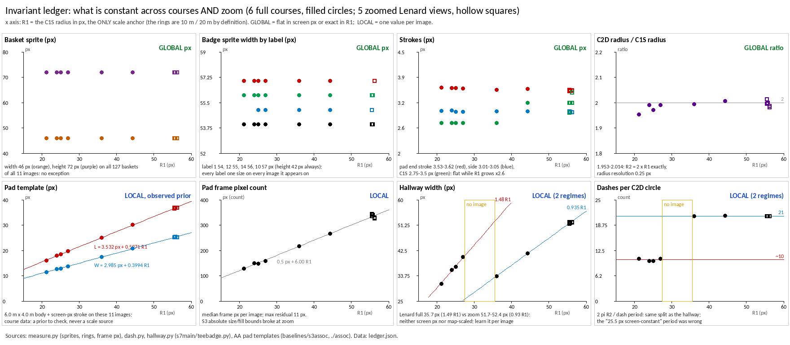

# Invariant ledger: what is constant across courses AND zoom

Sam (2026-10-17): "Nothing may be asserted to be constant unless it holds
across both courses and zoom scales. In blind prod runs, detecting that which
is constant locally is an INCREDIBLY POWERFUL ORIENTATION/specialization we
get for free."

Measured on 6 full courses (golden, alex, lenard, townelake, heritage,
northpark) and 5 zoomed Lenard views (Lenard-1..5, each one screenshot, no
assembly). The x axis of every panel is R1 = the C1S radius in px, i.e. the
image's map scale (10 m on the ground).

**Scale comes from the rings only** (Sam, 2026-10-18: "pad size COULD vary.
Circle1Radius and Circle2Radius WILL NEVER VARY"). The rings are the app's
definition (10 m, 20 m). Pads and hallways are course data: however constant
they looked here, they are predicted from the ring scale and checked, never
used to set it.

| scope | quantity | value | evidence |
|---|---|---|---|
| GLOBAL | basket sprite | 46 x 72 px | 127 baskets, 11 images, no exception |
| GLOBAL | badge sprite by label | 54/55/56/57 x 42 px (label 1-9, 11, 17: 54; 12, 13, 15, 16, 18: 55; 14: 56; 10: 57) | every label one size on every image it appears on |
| GLOBAL | pad frame stroke | ends 3.53-3.62 px, sides 3.01-3.05 px | AA render fit; flat while R1 grows x2.6 |
| GLOBAL | C1S stroke | 2.75-3.5 px FWHM | 0.25 px radial steps |
| GLOBAL | C2D radius / C1S radius | 2 (1.953-2.014) | radius resolution 0.25 px |
| OBSERVED prior | pad template | length = 3.53 px + 0.597 x R1, width = 2.99 px + 0.399 x R1 | max residual 0.27 px / 0.16 px on these 11 images: a 6.0 m x 4.0 m body plus the screen-px stroke (intercepts = the strokes). Course data: another course's pads could differ |
| LOCAL (px), fixed on the ground | R1 | 21.25-56.25 px = 10 m | one radius per image; the only scale anchor |
| LOCAL | pad frame px | 129-344 px (count) | ~0.5 px + 6.0 x R1 |
| LOCAL | S3 band fill | median 0.80-0.82 full, 0.61-0.64 zoom (fraction) | an absolute bound found no anchors at zoom |
| LOCAL | hallway width | 31.03-52.38 px | IQR within an image <= 0.48 px |
| LOCAL | C2D dash period | 21.5-33.5 px of arc | NOT screen-constant (an earlier reading said 25.5 px) |
| LOCAL, 2 regimes | hallway width / R1; dashes per C2 circle | 1.46-1.49 and 9.9-10.5 when R1 <= 27 px; 0.93-0.94 and 20.9-21.0 when R1 >= 36 px | full Lenard 1.489 vs its zooms 0.93: the regime follows scale, not course; no image has R1 in 27-36 px |
| VARIABLE | baskets vs badges in view | lenard4: 7 baskets, 6 badges | a zoomed view can show a basket whose badge is off-screen |

## Orientation for blind runs (`fg/scene/invariants.mjs`)

What is constant within an image is measured once and then predicts the
rest:

- **Scale from the rings, and nothing else.** From R1, the pad prior, the C2D
  radius and the hallway width are predicted before they are fitted.
- **Pad check.** The fitted pad template is compared with the prior at the
  ring scale. On all 11 images it matches within 0.27 px (length) and
  0.16 px (width). A course whose pads miss it gets a finding giving the
  pads' size in metres. The scale is untouched.
- **Regime.** Scale, hallway width / R1 and dash count vote; they agree on all 11
  images. Between R1 27 and 36 px nothing is assumed (`unresolved`).
- **Hallway prediction.** The regime ratio x R1 brackets the measured hallway
  width on all 11 images (in-sample: the ratios were fitted on these images).

## Hidden scale assumptions found and fixed

- **S3 structural fix** (`ports/early/s3FamilyFix.mjs`) required band fill in
  [0.65, 1.05]. Zoomed pads measure 0.52-0.67, so Lenard-3/-4/-5 had no
  anchor pad and the lane threw "found no anchor pads".
  - Now the screen-px tests (frame margins, contrast, white frame) select
    candidates, and band fill must lie within 0.75-1.3 x the image's own
    median.
  - On the 6 full courses and Lenard-1/-2 every refined tee keeps its centre
    (within 1 px).
  - On Lenard-3/-4/-5 the fix now runs. It drops the one baseline candidate
    that is the letter "a" of the Apple "Maps" watermark, at (143, 2067),
    which was an S3 false positive.
- **s7main `course.py`** searched radii 10-110 px for the (R, 2R) ring pair,
  which silently capped R1 at 54.75 px. Zoom R1 is 55.5-56.25 px. The range
  is now 10-260 px; full-course R1 is unchanged.
- **S2 observer**: "baskets <= badges" and the S4 deficit are judged only in
  a full view (labels 1..18).

## Files

- `measure.py`: sprites, rings (pair fit), and pad frame px. Writes `measure-raw.json`.
- `dash.py`: C2D dash period, using C1S as the no-dash control. Writes `dash-raw.json`.
- `hallway.py`: hallway width per image, via `../s7main/teebadge.py`, unchanged. Writes `hallway-raw.json`.
- `assoc/`: frozen S3 associations for northpark and Lenard-1..5. These are
  the same `baselineOf` as `baselines/s3assoc/`, from the structural-fix
  attempts named in `../s7main/course.py`. There is no testimony for them,
  so they are geometry only, never judged.
- `build.py`: classifies each quantity and writes `ledger.json` and `ledger.png`.
- `fg/scene/invariants.test.mjs` checks `invariants.mjs` against `ledger.json`.
