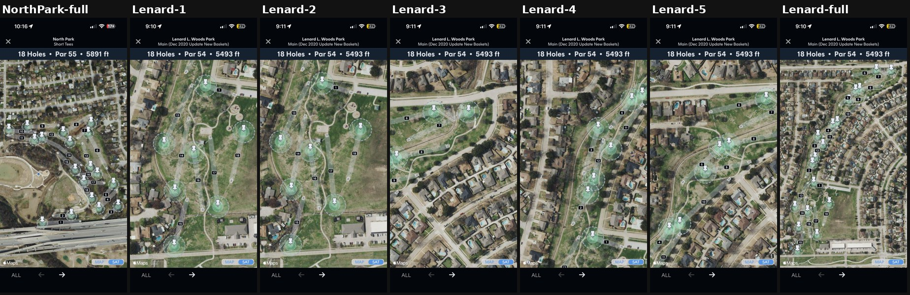
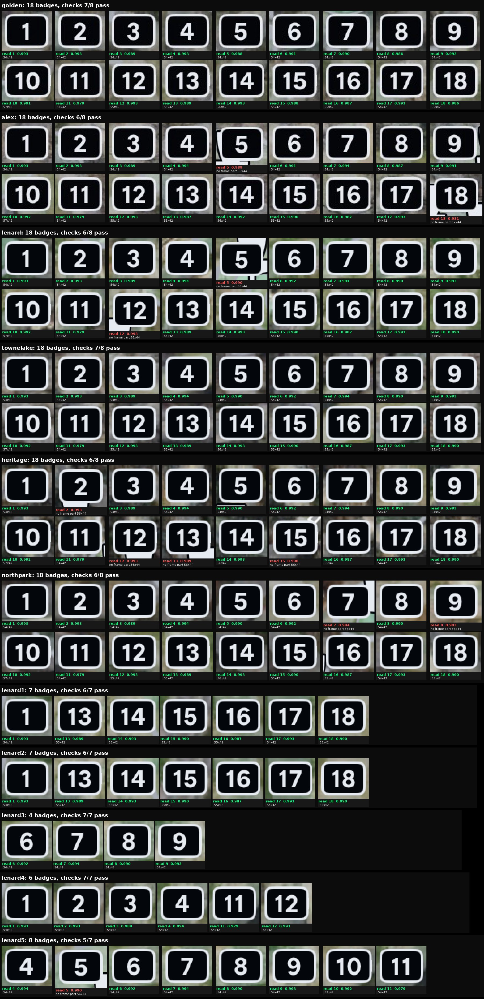

# S1 on the whole dev set (11 images)

The 5 annotated courses plus NorthPark-full and Lenard-1..5. Lenard-1..5
are zoomed views: the map scales and sprites stay screen-size, and only part
of the badge set is visible. Validation stays held out; sealed/ stays
off-limits. Each image runs as a pinned `--until 1` Attempt (`runall.sh`),
about 7 s each.

| image | badges | merged frames (off-size, explained) |
|---|---|---|
| golden | 18 (full) | - |
| alex | 18 (full) | 5, 18 |
| lenard | 18 (full) | 5, 12 |
| townelake | 18 (full) | - |
| heritage | 18 (full) | 2, 12, 13, 15 |
| northpark | 18 (full) | 7, 9 |
| lenard1 / lenard2 | 7 (1, 13-18) | - |
| lenard3 | 4 (6-9) | - |
| lenard4 | 6 (1-4, 11, 12) | - |
| lenard5 | 8 (4-11) | 5 |

All 140 reads are correct by eye, with confidence >= 0.979.

Robust base learned here, now observed on every run by
`fg/s1/fg.s1.badgeInvariants.observe.fg.mjs` (recorded in the S1 receipt,
never a gate):
- **Size is a function of the label alone.** One size per label over 129
  clean badges: 54x42 px for 1-9, 11 and 17; 55x42 for 12, 13, 15, 16, 18;
  56x42 for 14; 57x42 for 10.
- **An off-size badge is exactly a frame merged with a touching white
  sprite** (11/11, no exceptions either way). Its first bright S1 part is
  then a digit, so the centre must come from the bbox or the plate.
- Bbox and dark-plate centres agree within 0.5 px on every badge.

Receipt finding: S1's counter expectation table is golden's, so it "fails"
on every zoomed view and on alex (one AA pixel). It needs to be keyed per
specimen.
