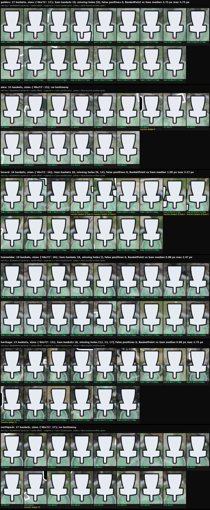

# S2 on the 6 single-image dev courses

Lenard-1..5 are held back until we do screenshot assembly.

| course | baskets / badges | S4 recovers | missing per Sam | false positives | BasketPoint vs Sam (median / max) |
|---|---|---|---|---|---|
| golden | 17 / 18 | 1 | hole 6 (the 4-6 cluster) | 0 | 3.75 / 3.75 px (golden's annotation offset) |
| alex | 15 / 18 | 3 | no basket testimony | - | - |
| lenard | 16 / 18 | 2 | holes 9, 12 | 0 | 1.09 / 3.27 px |
| townelake | 18 / 18 | 0 | - | 0 | 0.88 / 2.47 px |
| heritage | 15 / 18 | 3 | holes 12, 13, 17 | 0 | 0.88 / 3.75 px |
| northpark | 17 / 18 | 1 | no testimony | - | - |

Robust base, now observed on every run by
`fg/s2/fg.s2.basketInvariants.observe.fg.mjs` (recorded in the S2 receipt,
never a gate):
- the sprite is 46 x 72 px on all 98 baskets;
- the BasketPoint is recorded for every basket;
- no duplicate detections, and never more baskets than badges;
- the deficit against S1's badge count is S4's recovery hand-off, and it
  matches Sam's missing baskets exactly on every annotated course.

Sam's basket points sit either ~0.9 px or ~3.75 px from the BasketPoint.
That is two annotation conventions (stem edge vs about 3 px up), not two
sprite geometries.
