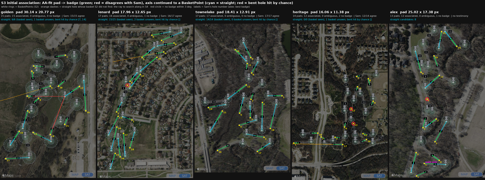
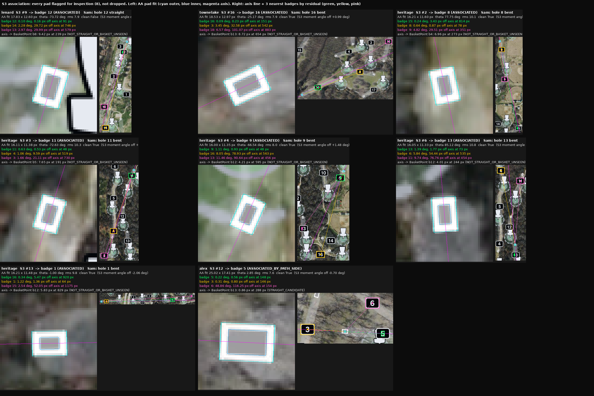
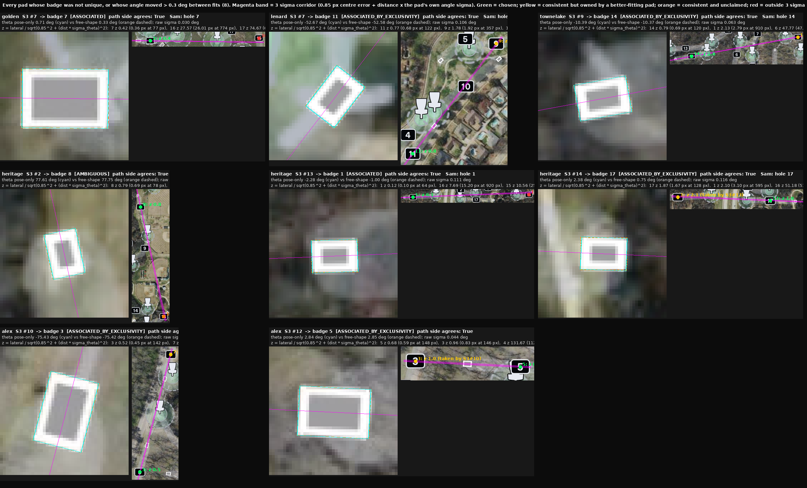
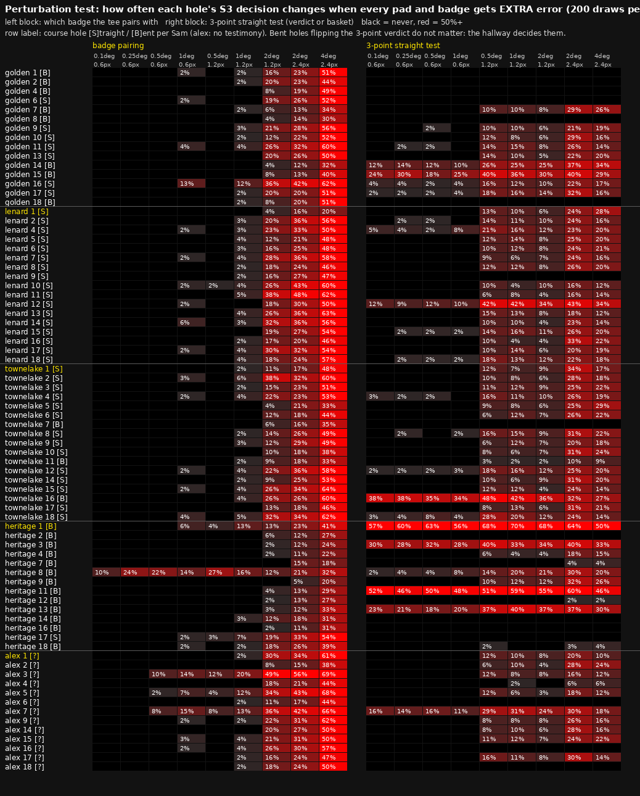

# S3 initial association (ports/s3assoc)

Sam (2026-10-17): unoccluded pads associate with at most 2 badges, one an
obviously better fit; straight-hole matching (S5) can be largely done before
recovery starts.

`node ports/s3assoc/run.mjs --specimen NAME --attempt ID`:
1. Fits every visible pad as an AA render (`padPose.mjs`, ported from the
   numpy prototype; it reproduces Alex's template 25.019 x 17.377 px).
2. Associates each pad's axis with badge centres within 3 deg (`associate.mjs`).
   An opposite-sense tie is broken by the side the path leaves from.
3. Continues the axis past the badge to the nearest BasketPoint.

| course | badge agrees with Sam | straight holes called straight (basket seen in S2) | straight, basket unseen in S2 | bent holes hit by chance |
|---|---|---|---|---|
| golden | 15/15 | 6/6 | 1 | 7, 14 (507-552 px; S6's ribbon must reject) |
| lenard | 17/17 | 15/15 | 2 | - |
| townelake | 17/17 | 14/14 | 0 | - |
| heritage | 14/14 | 0/0 | 1 | - |
| alex | no testimony; 13/13 associated (S3 #12 by path side: badges 5 and 3 sit on opposite ends of one axis) | 8 candidates | | |

## Nothing is dropped: tracked and rendered for inspection

Every pad keeps its 3 nearest badges by axis residual, with no angle cutoff.
`inspect` flags:
- a pairing more than 2 px off the axis;
- any tie or no-badge verdict;
- an axis that misses a BasketPoint by 3-10 px.

The first version dropped 3 pads as "no badge". Rendering them showed the
measurement was ours: the "badge centre" was the first bright S1 part,
which on 5 badges (lenard 12; heritage 12, 13, 15; alex 18) is the digit
"1" (7 x 21 px). Their white frame is not its own S1 part, which is an S1
finding. With the badge bbox centre, all 76 pads on 5 courses sit within
**1.90 px** of their badge (median 0.65 px):

| course | lateral px median / max |
|---|---|
| golden | 0.67 / 1.83 |
| lenard | 0.65 / 1.55 |
| townelake | 0.60 / 1.48 |
| heritage | 0.96 / 1.90 |
| alex | 0.49 / 0.81 |

The error is a constant ~1-2 px of position, so thresholds are in px, not
deg (Heritage's badges are only 45-128 px away).

- The S3 moment angle is off by a median 1.27 deg (max 6.28 deg) from the AA
  fit. With it, only 46/63 associations were right; the AA pose is what
  makes association work.
- Path side is crude and calibrated on golden/heritage/alex (badge on the
  path side 15/15, 11/11, 11/12). On lenard (8/16) and townelake (13/17) the
  strip test itself is suspect, so it is only used to break ties.

## Uncertainty, not degrees: association by z, global and one-to-one (Sam: "several of those pads are off just enough to favor a different badge")

- **Pose-only refit.** Pads are rigid per course, so pass 2 refits pose only
  against the course template. Size can no longer trade against angle.
  Near-axis-aligned pads moved the most: heritage S3 #13 by 1.28 deg and
  S3 #14 by 1.63 deg. Each fit also reports its own angle sigma, from
  profile curvature.
- **Calibration** (`calib_sigma.py`, 76 confirmed pairings). The lateral miss
  is a constant sigma0 = 0.85 px and does not grow with distance over
  45-214 px. |z| median is 0.76 (0.67 expected), max 2.16.
- **Why badges looked favoured.** Ranking by deg made far badges look better:
  heritage S3 #2's badge 15 at 814 px read as 0.24 deg against badge 8 at
  0.64 deg. In px, with each pad's own angle sigma, such badges sit at
  z 2-8.
- **Rule.** z = lateral / sqrt(0.85^2 + (dist x sigma_theta)^2). Badges with
  z <= 3 are consistent. Pairs are taken in increasing z, each badge and pad
  once.

Results:
- **63/63 agree with Sam; Alex 13/13 associated.**
- 5 pads have a second consistent badge owned by a better-fitting pad:
  lenard S3 #7, townelake S3 #9, heritage S3 #14, alex S3 #10 and #12.
- 1 is AMBIGUOUS: heritage S3 #2. Its alternative, badge 15 at 814 px
  (z 2.59), is unclaimed only because heritage tee 15 is not visible. S4
  recovering that tee settles it.
- The path side agrees with the chosen badge in all 6 cases. It is recorded
  as evidence, not used to decide.

## Frozen, and the perturbation test (Sam: "freeze it and run the perturbation test")

Frozen per hole in `baselines/s3assoc/<course>.json`: tee centre, ray to the
badge, z, and the 3-point straight test. Every check compares geometry, not
bytes, through `contracts/s5.pair@1` plus the 3-point verdict and BasketPoint
(`node ports/s3assoc/freeze.mjs --specimen X --attempt ID`).

The 3-point test (Sam's order: tee -> badge -> 0-bend holes by the 3-point
test -> n-bend holes by pathfinding) checks that tee centre, badge centre and
a BasketPoint are collinear. It uses no pad angle.
- All 35 straight holes whose basket S2 found pass with the right basket.
  TLS max is <= 0.76 px; the threshold is 1.5 px.
- 7 bent holes line up with ANOTHER hole's basket by chance: golden 7, 14
  and 15, townelake 16, heritage 1, 8 and 9. The hallway must reject them.

`perturb.mjs` adds Gaussian error to every pad (centre and angle) and every
badge centre, re-runs association, and counts per hole how often the
DECISION changes (200 draws per level).

The test found three defects, all fixed before the freeze:
1. Greedy assignment stranded a pad when a neighbour took its badge (lenard
   hole 11's tee took badge 9, so hole 9 lost its tee). Fixed with a
   minimum-cost one-to-one matching (Hungarian, sum z^2).
2. A hard z <= 3 cutoff dropped pads. Unmatched pads now take a badge up to
   z 8, flagged weak.
3. Straight holes took the most collinear basket, not the first one on the
   line. The frozen lenard holes 2 and 4 were 448 px and 708 px from Sam's
   basket; with the first-on-line rule both are 1.1 px from it.

At extra error equal to our measured error (0.6 px per point, 0.1 deg):
- **Badge pairing changes in 1 hole.** Heritage hole 8 (10%) is pulled to
  badge 15, which is unclaimed because heritage tee 15 is hidden.
- **3-point verdict on straight holes changes <= 5%**, except lenard 12
  (12%), whose basket S2 did not find.
- Badge pairing stays stable to 1 deg / 1.2 px. Only heritage 8 and alex
  holes 3, 5 and 7 (badges 3 and 5 on one line) move by more than 10%.
- The 3-point test has about 1x margin: at 1.2 px straight holes drop to
  BENT in 10-28% of draws. That direction is safe, since a straight hole
  sent to pathfinding still gets solved. The unsafe direction is BENT ->
  STRAIGHT (heritage 1, 3, 11, 13; lenard 12), so the hallway must confirm
  every STRAIGHT.
