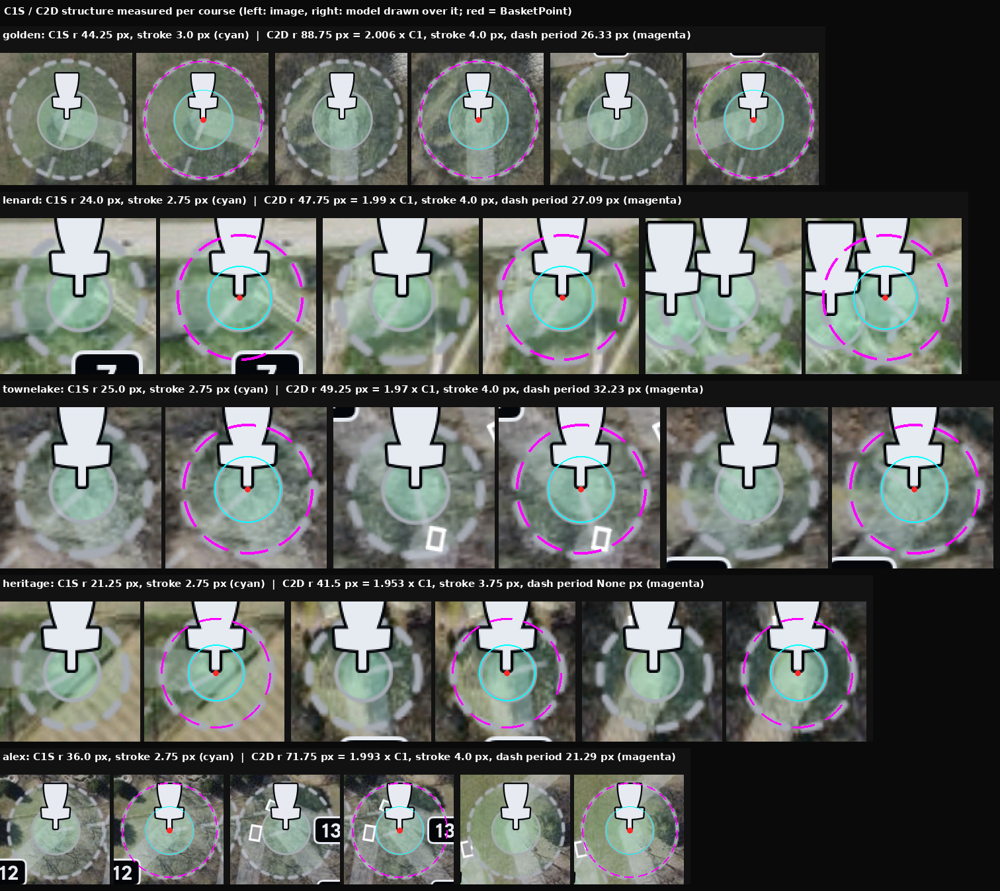

# Scene Parts with structure: C1S, C2D, HolePath (`fg/scene/parts.mjs`)

Sam (2026-10-17): "these are by definition NOT fully visible" (pads crossed
by translucent rings), and "give each thing Structure which is hopefully
Legible". Every rendered element is now a Part with geometry, so occlusion
is accounted for by name, opaque or translucent:

| Part | structure | rendering |
|---|---|---|
| C1S | centre = its basket's BasketPoint, radius R1, stroke w1 | solid translucent ring |
| C2D | centre = BasketPoint, radius R2 = 2 x R1, stroke w2 | dashed translucent ring; dash phase not modelled yet, coverage = whole annulus |
| HolePath | TeeBadgeSegment (tee front stroke -> badge, always straight) + Badge -> [Bend]* -> BasketPoint, width W | translucent tint, round caps |

Ring structure per course (`ringfit.py` -> `baselines/scene/<course>.rings.json`)
comes from the radial luminance around every BasketPoint, opaque sprites
masked. C1 and C2 are fitted as the pair (R, 2R): on small-scale courses C1
sits mostly under the basket sprite, so its own peak is weak.

| course | C1S radius | C2D radius | C2/C1 | C1S stroke | C2D stroke | colour |
|---|---|---|---|---|---|---|
| golden | 44.25 px | 88.75 px | 2.006 | 3.0 px | 4.0 px | (166,171,180) |
| lenard | 24.0 px | 47.75 px | 1.990 | 2.75 px | 4.0 px | (166,171,180) |
| townelake | 25.0 px | 49.25 px | 1.970 | 2.75 px | 4.0 px | (166,171,180) |
| heritage | 21.25 px | 41.5 px | 1.953 | 2.75 px | 3.75 px | not sampled (crowded) |
| alex | 36.0 px | 71.75 px | 1.993 | 2.75 px | 4.0 px | (169,172,179) |

Stroke widths are screen-constant. **Open:** dash period is 21-32 px; golden
and alex have ~21 dashes per circle, lenard and townelake read ~10.

## The judge now names every occluder of a missed tee

| missed tee | what crosses its footprint | owner |
|---|---|---|
| golden Tee 3 | C2D of Basket 5 (15%) | S3: see through translucent rings |
| golden Tee 5 | C2D of Basket 6 (13%; Basket 6 not in S2, Sam's point), C1S of Basket 4 (11%) | S3 |
| lenard Tee 3 | C2D of Basket 12 (26%; not in S2, Sam's point) | S3 (+ S4 for Basket 12) |
| golden Tee 12 | Basket 11 (10%) | S4 |
| townelake Tee 13 | Basket 14 (7%) | S4 |
| heritage Tees 5, 6, 10 | Baskets 4, 5, 9 (51-68%) | S4 |
| heritage Tee 15 | Badge 15 (40%) | S4 |
| alex Tee 13 | Basket cb (68%) | S4 |

Percentages are the share of the pad footprint (half the pad diagonal
around Sam's point) each Part covers.
