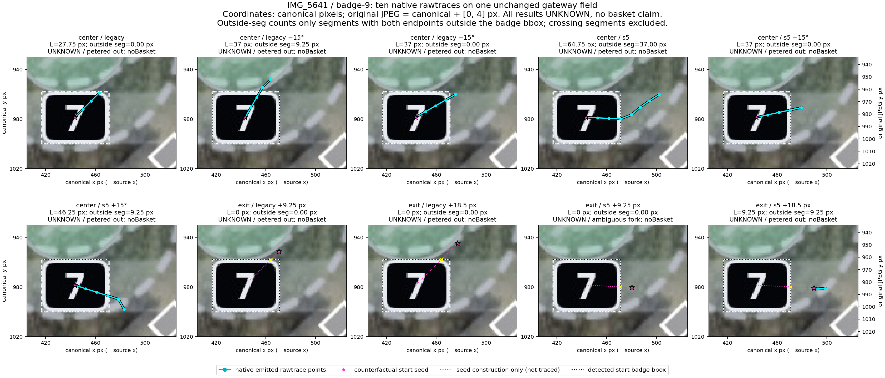
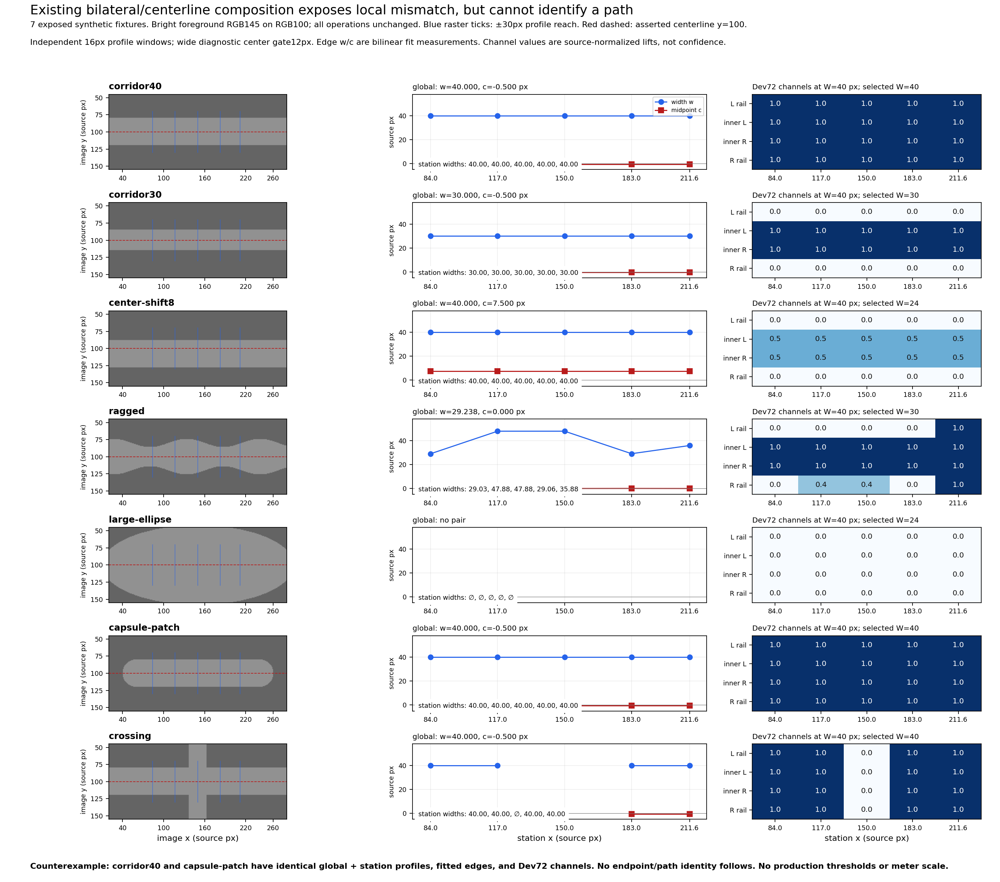
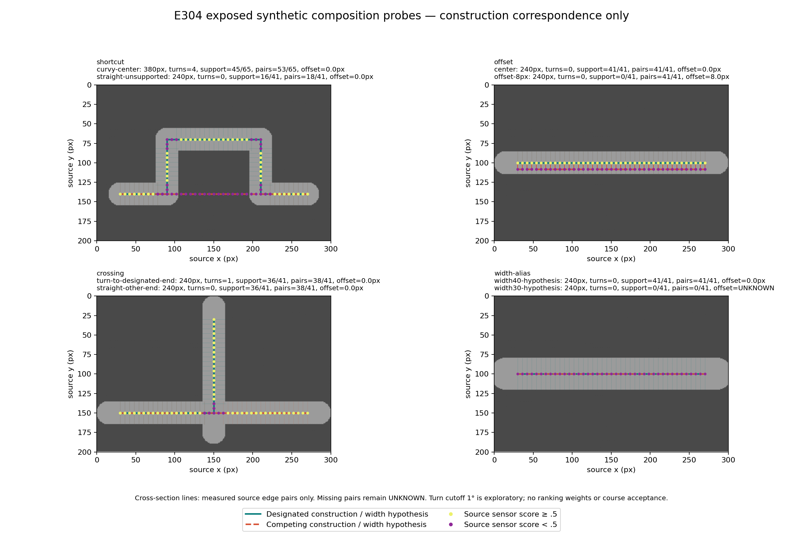
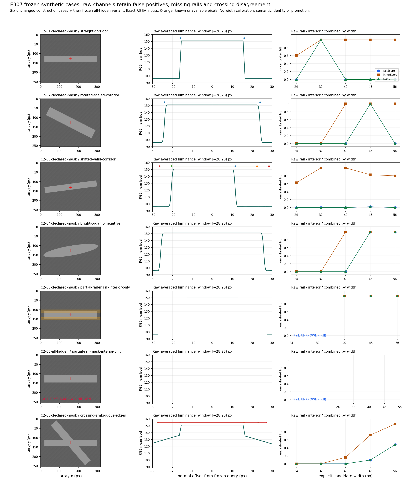

# Capability Discovery Lab — cycle 02 continuation

This is a historical execution record and guarded resume point. Publication is pending. It does not authorize dispatch, production integration, a PR, a merge or deployment. The coherent candidate branch remains `codex/capability-discovery-lab`; cycle start local `a210aed` and published `7c59b053f09b27d4685c754738b50a987fa0eeed` have exact tree `340903effe6cf7fd9e83e113cf8a8b7a48f97613`. Main `37a2dba`, reference algorithm `e3e11fab` and platform `4925533` were unchanged in the root's fresh connected read. No earlier frozen source/evidence bytes are replaced by this cycle. Before checkpoint preparation, an authorized existing-origin fetch independently resolved published7c59 and exact tree340903; the sole owner soft-aligned the same local branch to that published parent while preserving all untracked work. [The alignment receipt](administration/git-alignment.json) records unchanged candidate hashes and no commit/push.

The new deliverable is an executable, default-OFF [local ribbon evidence composition](../../../experiments/capability-discovery/composition/README.md). It takes immutable provenance-bound RGBA, explicit same-frame tee/badge training segments, station poses and windows, LOCAL candidate widths, known occluder boxes and explicit edge-search settings. It calls the exact existing learner, four-lane observer and JS profile/width-search/edge-pair operations. Every raw candidate row, channel, profile visibility count and paired fit is retained. Only an actual finite two-edge fit supplies a midpoint offset. Calibration, semantic path identity and acceptance remain UNKNOWN; promoted=false. There is no new detector, tracker, path score, learned weight, recentering or production wiring.

The current repaired source-only freeze is [feature-manifest-E308.json](feature-manifest-E308.json), SHA256 `5b59dce1c7ae87f962c0305697ed883e423bd504fedce5851fb02242309dcf52`. The original E306 freeze [feature-manifest.json](feature-manifest.json), SHA256 `9ecd88635ed69ca8fb8e44ff044ac1e8fd704133c5687685b9a3114893ed9cd0`, remains historical with its exact files under [history/E306-first-freeze/](history/E306-first-freeze/). Independent [R306](reviews/R306/result.json) returned AMEND: source arange expanded decimal bank31.01 into31.01 and32.010000000000005, admitting a33px pair outside the requested31.01±1px source tolerance. [E308](evidence/E308/E308-result.json) first reproduced the old failure, then changed only the caller to existing `edgePairOf(sharedProfile, exactRequestedWidth, explicitSettings)`. The same case now returns no pair and midpoint UNKNOWN. All10 candidate controls pass; no vendor bytes changed. Independent [R308](reviews/R308/result.json) accepted the exact caller repair after14 frozen file/guard/source checks,10 tests and8 direct source width oracles. This is technical acceptance of the bounded caller, not physical width or course acceptance. E307 completed seven actual CLI calls on the six unchanged frozen C2 cases plus their frozen all-hidden variant after accepted R305/R308. Root then explicitly released the artifacts to C6 for packaging. No evaluation-feedback tuning is permitted; all released cases are exposed for future work. Independent [R307](reviews/R307/result.json) accepted the bounded evaluation record after all seven raw receipts/HTML pages/measurements/source closure/figure reproduced byte-for-byte and all31 frozen entries were verified. This acceptance does not establish classifier success, calibration, path truth or human acceptance. [RESUME.md](RESUME.md) and [next-packets.json](next-packets.json) state the gates.

| Packet | Actual new evidence | Inference boundary |
| --- | --- | --- |
| E301 / C1 | Ten IMG_5641 heading/start counterfactuals on one unchanged actual gateway support/theta field; all UNKNOWN/no basket. Baseline27.75 and S5-heading64.75 canonical px reproduced. Four outside-badge seeds continued0,0,0,9.25px. | Initial badge-exit bypass did not establish sustained routing. Same-field same-process repeats were exact; R301 independently reviews fresh-process replay. |
| E302 / C3 | Seven exposed fixtures,35 station profiles. Shifted center c7.5px; recentered original sensor score1. Ragged station widths29.026–47.875px despite global29.238px. Crossing global40px/mean.8 conceals central absent pair/score0. | Organic capsule exactly matches corridor40 profiles/channels/fits. Bilateral geometry does not establish semantic path identity. |
| E303 / C5 | Ten exposed width-transfer fixtures. Bright ellipse uniquely learns40, mean1/margin1, edges72lum/px, yet transferred40 fails true nominal30/raster29 at all four stations. Reverse transfer falsely agrees with organic ellipse. | Strict separation, gradient strength and independent exposed station agreement are insufficient renderer provenance. All-hidden/tied returns20 abstain. Frozen occlusion prediction failed and remains reported. |
| E304 / C4 | Eight supplied route candidates. Crossing designated-turn and straight-other-end both240px, support36/41,pairs38/41,observed midpoint offset0; turn counts1vs0. Unsupported shortcut pairs18/41 and supported samples16/41. | Fewer bends can select the wrong construction endpoint. Conditional offset0 excludes missing pairs; shortcut has23 missing pairs. No ranking weights or real-course claims. |
| E305 / C2 | Independently frozen generator/protocol, reviewed by R305 without reading/executing C6 candidate. Public summary reports27 generated files and31 frozen entries verified. | Withholding is procedural on a shared filesystem. Geometry/evaluator remain embargoed until root release after accepted protocol and candidate reviews. |
| E306 / C6 | Module+CLI+HTML inspection;8 core red tests before implementation,1 CLI red test before implementation;9 original candidate checks pass. Existing95 Lab checks remain unchanged. | Comparison measurements only; R306 AMEND is preserved. |
| E307 / C2 | Seven actual CLI calls retain ellipse score1/no fit, crossing score0/averaged pair, shifted pose offset, interior-only masked rails and all-hidden fallback. | Calibration/semantic identity remain UNKNOWN. Requested unsupported API channels stay unsupported; no physical accuracy acceptance. |
| E308 / C6 | Exact R306 decimal-bank regression failed old caller, then all10 controls passed repaired direct edgePairOf. | Current exact source is5b59dce1; R308 technically accepted; exact source remained unchanged throughout E307. |

Exact public source IDs, protocols, producers, raw measurements, figures and review reports are in [capture-manifest.json](capture-manifest.json). Reproduction uses the existing source closure and scratch staging described in [REPRODUCE.md](REPRODUCE.md); it does not write into preserved evidence. The634-file provider, JPEG, regenerable synthetic RGBA/prepared rasters, duplicate figures and tarballs are omitted. The three PNG figures were inspected by their producers and by C6; R301 independently rerendered the native figure with identical PNG hash. The current retained E301 figure/report are the finalized accepted review bytes; C6's HTML screenshot attempt could not launch because the installed Playwright package lacked its Chromium binary. CLI HTML content was checked, but visual HTML rendering is unverified.

The [R304 amendment](evidence/E304/amendment-R304.json) preserves the original report hash `887f978b6984732101cd1a590b1fce8fadb93f29d371c61175887925aafbee40` and revised hash `f4a4ce6e3b424aed178e8bc9cf3563b9d05bbef4471846c725dce5a4e6f69bbd`: the sole text correction is27→23 missing pairs for18/41 observed pairs. All raw measurements, protocol, source and figure were already correct. The reconstructed initial snapshot is explicitly labelled; it is not described as an untouched archived original.

Scheduling erratum: epoch00 selected all six jobs before actual spawns. Root recorded four start acknowledgements at08:55, then noticed the missing C1/C4 state acknowledgements at resumption and recorded their starts before their new probes. Those agents were already active assigned workers, never spare capacity. No intervening native solve occurred during that mismatch. Native events retain their recorded times; the delayed acknowledgement is not rewritten into an08:55 event. C6 later held an explicit E399 ADMIN lease for sole-owner packaging and did not review its own candidate.

Verification is bounded and candid. The root ran the exact current combined Lab command after E308:105/105 passed (original95 plus10 candidate tests), recorded in [verification/current-root-lab-105.log](verification/current-root-lab-105.log). The earlier104 test run and nine-test first-freeze logs remain historical. Bare `node --test` at E306 ran149 tests:143 passed and the same six missing-fixture failures remained (inventory checkpoint; accepted S2 basket assembly;18 badges;17 baskets;18 tees; strict JPEG/native closure reuse). [verification/](verification/) retains the actual logs. No full-suite green claim, threshold reduction, accepted confidence policy, physical scale, production default change or AA muting is supported.

The [native snapshot](native/snapshot-context.json) is in progress and explicitly reserves C6 for E400 ADMIN at capture; it never advertises that worker as free. Native assignment receipts are historical evidence, not a live service or permission to reuse availability. Refresh root state, agent occupancy and route authority before another solve. Scientific retention remains a human decision. Technical reviews certify only their stated bounded scope.

Accepted public reviews R301–R305 bind their own reviewed hashes and bounded interpretations. R301 adds a fresh-process same-machine replay to E301; R302/R303 reproduce portable exposed receipts; R304 verifies the corrected narrative and unchanged measurements; R305 verifies generator/protocol integrity while leaving private C2 geometry withheld. None is human scientific acceptance. The raw AMEND is retained alongside the repair rather than replaced by a later green test.

The next useful scientific step is a separately frozen source-pixel probe on actual independent images with matched positive/negative controls and explicitly supplied geometry testimony. Do not repeat the ten unchanged badge-exit variants or infer a new score from fewer turns, stronger gradients or an exposed agreement fraction. AA/sampling semantics and source-frame uncertainty must remain visible; absent independent identity evidence means abstention. E309 exposed sampler/AA exploration is outside the candidate freeze:16 fixtures/64 poses,48/64 tied learner rows, nominal sensor scores1 throughout, profiles varying in16/16 fixtures, and AA nominal edge-fit span up to0.293478px versus crisp span0. It falsifies a blanket AA fit-stability benefit on this construction. Its exact result/protocol/producer/raw rows are retained at evidence/E309/; independent [R309](reviews/R309/result.json) accepted the exact reproducibility and scoped exposed interpretation. Nominal-width channels stay1; the6/16 changing-channel finding concerns only non-nominal bank widths. No AA muting, production behavior or candidate-source change follows.

Capacity changed during the actual cycle: the initial six-worker Lab pool was reduced to four (C2,C3,C5,C6) after idle C1/C4 completed their packets, because two separate cheap HH workers were active. No running Lab worker was removed. The recorded global allocation was four Lab plus two HH plus root, seven total. C6 remained reserved for E400 ADMIN. Initial six-worker feasibility does not imply six current free workers. HH source work and publication are separate; this Lab package contains no HH or PageRouter mutations.

The released [E307 result](evidence/E307/result.json) and [figure](evidence/E307/evaluation.png) retain all seven actual outputs. Straight32 fits32px; rotated48 fits48.00106px. Shifted32 gives fixed-pose combined0 and center-minus-midpoint4.49853px. The ellipse has combined1 at48/56 but no source pair. The crossing has combined0 at32 while an averaged profile pair fits32.01746px. Masked rails are null/UNKNOWN despite interior/combined1; all-hidden raw24 has0 visible samples and tagged−Infinity, with no learned width. Additional weak texture/boundary fits remain raw diagnostics without a confidence cutoff.

Full band luminance means, enumeration of all alternative edge pairs and profile-boundary safety/calibration flags are unsupported by this API. Frozen requests for those channels are not relabelled PASS. E307/HTML content checks and scientific figure inspection do not establish browser-visual validation or course accuracy. The exact source freeze remains5b59; released inputs cannot be used to tune this cycle.

Independent [R400 package audit](reviews/R400/result.json) accepted the exact220-entry inventory at [package-manifest.json](package-manifest.json), SHA256 `5cc1894f8e95b22636269cba13b4b55a319d7028e92deb7a0f656e0547731215`. That manifest and its original navigation bytes remain historical and unchanged; [post-review-manifest.json](post-review-manifest.json) explicitly labels the root-approved final review records, native receipts and brief continuation additions. R400 did not audit those later bytes. The final [native capture](native/final-admin-context.json) records C6 E499 ACTIVE before its authorized local commit/payload task completes. Root authorized that one local checkpoint on published parent7c59; connected publication and exact remote commit/tree verification remain pending. No PR, main merge or deployment is authorized.
