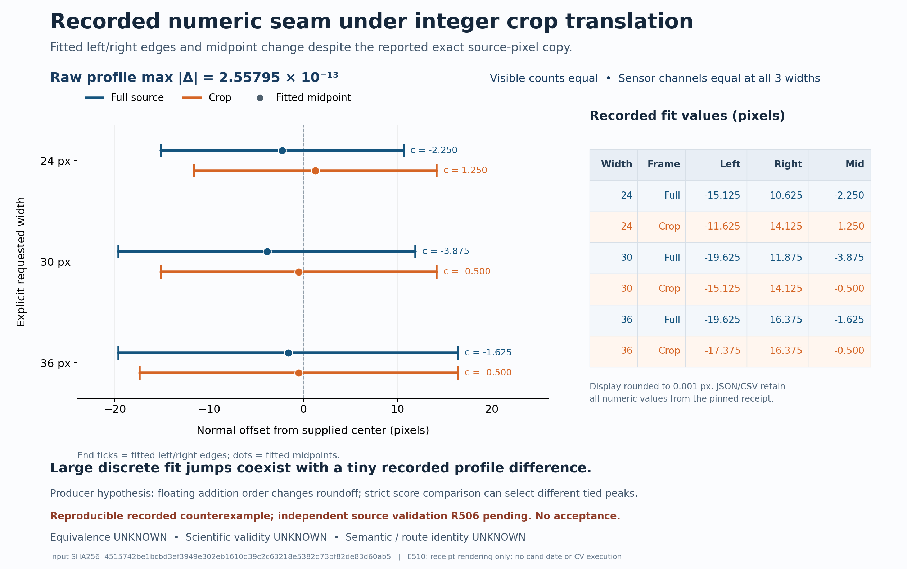
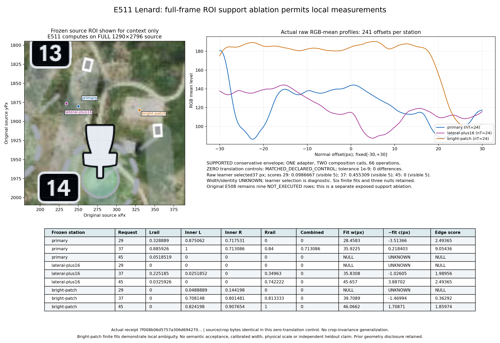
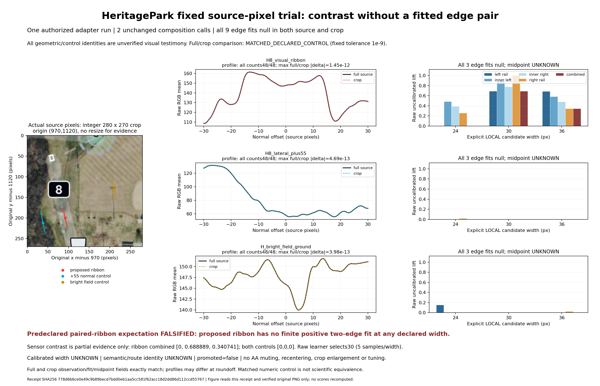
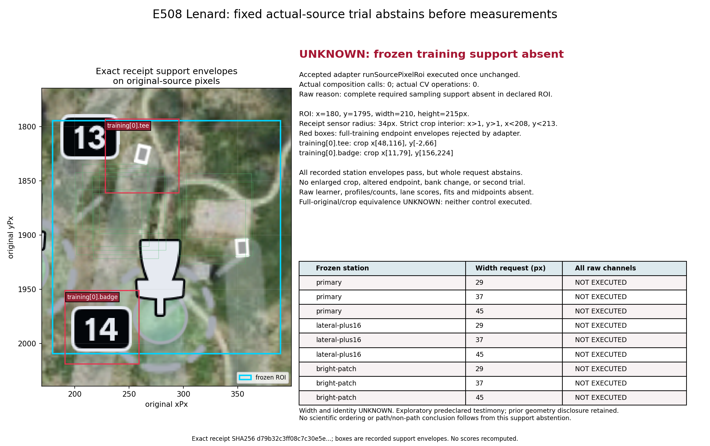
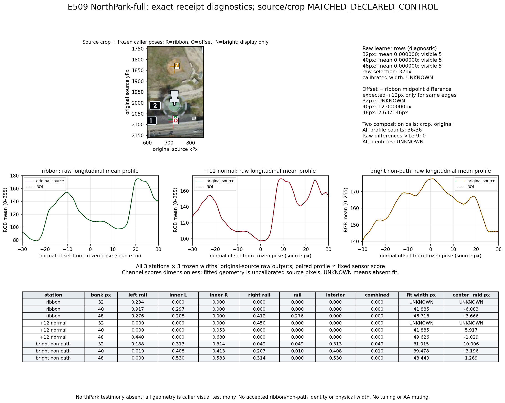
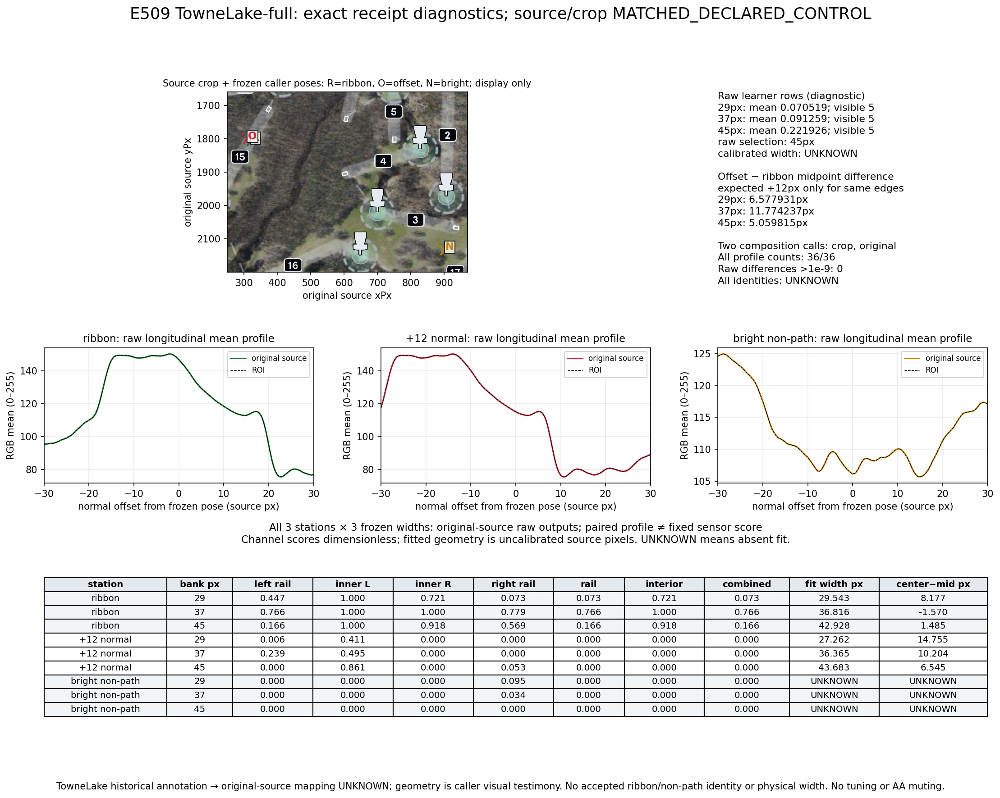

# Capability Discovery Lab — cycle03 actual source pixels

This package adds a standalone, default-OFF [source-pixel ROI adapter](../../../experiments/capability-discovery/source-pixels/README.md) around the exact accepted5b59 composition. It copies actual RGBA pixel rows without resize, preserves alpha, translates all supplied geometry by the declared integer ROI origin, verifies available hashes and conservatively rejects incomplete sampling support. Every supported run retains two unchanged composition executions: crop and full RGBA in the exact original frame. No CV mathematics, provider/source/fg/ports, HH, main branch or production default changes.

The accepted source-only [E506 freeze](evidence/E506/candidate-freeze.json) has SHA256 `d31b7a4312ac1bfc4f76bc96fc278f8acad4f49f4b04283df0faa8e6dce54626`. [R506](reviews/R506/result.json) technically accepted those exact23 source/history entries plus the unchanged14-entry recipe closure after85 independent probes and8/2/10 focused tests. This does not accept crop-only reuse or scientific path truth. The root's aggregate engineering run passed113 Lab tests plus2 staging tests; the original full-repository six missing-fixture failures remain recorded in cycle02. This cycle makes no full-suite-green claim.

Exact pixel copying does not guarantee numerical fit invariance. The first-source rotated control failed: profiles differ by only2.56e-13 but legacy strict peak selection jumps several pixels. First source, red log and contract are immutable under [history/E506-first-source](history/E506-first-source). The [separate amendment](evidence/E506/contract-amendment.json) mandates paired controls and retains every output disagreement above the unchanged1e-9 numerical tolerance as equivalence UNKNOWN. R506 independently found another concrete failure: a sample rounds at full x160.49999999999997 versus crop x100.5, producing leftRail0.8 versus0. Both raw receipts and the failed equivalence remain under [reviews/R506](reviews/R506). No tolerance reduction, AA muting, tie repair or legacy fitter change follows.

E510 renders the exact recorded seam receipt and was independently checked by R510. Its historical footer says R506 pending because that was true at render time; current accepted R506 is a separate record. Rendering a recorded table is not another execution of the fitter.

The four actual-source declarations were frozen before their producers. They are exposed exploratory caller-selected regions, with original-frame visual testimony and explicit positive/offset/bright controls. D2/D3 accidentally sent geometry to the adapter owner before source freeze. Reported nonuse and source-derived constants are testimony, not authenticated blindness; no heldout scientific-evaluation claim is made. Unknown annotation-to-full-source mappings are not guessed. API names tee/badge, visual labels and brightness do not establish semantic endpoint ownership.

| Fixed actual trial | Actual execution | Retained observation | Boundary |
| --- | --- | --- | --- |
| [E507 HeritagePark](evidence/E507/result.json) | One adapter, two recipe calls;3stations×3widths | All9 crop and source edge fits null. Proposed-ribbon combined scores at24/30/36 are0/.688889/.340741 versus both controls0. Numeric control matched within1e-9. | Paired-ribbon expectation falsified. Raw learner30 and contrast do not establish measured width, identity or acceptance. |
| [E508 Lenard](evidence/E508/result.json) | One adapter, zero recipe calls/operations | Whole request UNKNOWN: training tee envelope minY−2 and badge maxY224 exceed215px ROI/strict interior. All9 rows NOT_EXECUTED. | Learner, profiles, fits and source/crop equivalence unobserved. No crop enlargement, dropped training or second trial. |
| [E509 NorthPark](evidence/E509/result.json) | One adapter, two recipe calls;3×3rows | Learner scores tie0; proposed ribbon/offset combined0. Bright visual non-path has finite pairs at all3widths. Same-edge +12 shift holds at40, unavailable at32, fails at48. | Concrete photometry ambiguity; no semantic discriminator or selected-success substitution. |
| [E509 TowneLake](evidence/E509/result.json) | One adapter, two recipe calls;3×3rows | Proposed ribbon37 has combined.765926/fitted36.8165px; offset combined0 with finite pairs; bright control all fits null. Midpoint deltas6.578/11.774/5.060 retain failed universal +12 expectation. | Raw learner45 and near-profile-edge fits remain diagnostics; no width calibration or boundary-safety claim. |

A separately authorized [E511 Lenard full-frame support diagnostic](evidence/E511/result.json) changed only ROI origin/size and crop-frame name, after R508 accepted the original abstention. Original geometry, training, widths29/37/45, windows, masks, source bytes and settings stayed exact. Its new pre-run declaration passed support and executed one adapter/two full-size recipes/66operations: six finite fits and three nulls across the same nine candidate rows. Raw learner37 and primary37 combined.713086 are diagnostics; bright and lateral controls also have finite fits. At37 the offset-minus-primary midpoint contrast is−1.24446px, which does not establish same-edge identity or the proposed+16 geometry. The zero-translation source/full-ROI control matches numerically by construction and supplies no generic crop-invariance evidence. Original E508 remains nine NOT_EXECUTED rows, not retrospectively measured. [R511](reviews/R511/result.json) independently accepted exact technical reproducibility after180 checks, one fresh replay/two recipes, byte-identical full receipt/bindings/CSV/actual figure and unchanged E508/R508. Its analysis scientific projection matches while process-resource observations differ; no scientific acceptance follows. The reported pre-freeze helper path typo has no retained raw traceback and is producer testimony only; [separate failure-history clarification](administration/E511-failure-history-clarification.json) records this gap. The receipt-only renderer error does have its original raw log. No missing traceback is reconstructed and no blanket raw-capture claim is made.

Independent [R507](reviews/R507/result.json), [R508](reviews/R508/result.json) and [R509](reviews/R509/result.json) accepted the exact bounded actual-trial records after fresh original-PNG staging and replay. They reproduced complete raw receipts byte for byte, including Lenard zero-call refusal and all failures/nulls. These are independent engineering replays of exposed trials, with four additional adapter invocations and six recipe calls; they are not additional independent scientific cases. R509 reproduced both actual figures exactly and checked TowneLake labels at original resolution; no display correction was needed.

NorthPark/TowneLake controls both match fixed numerical tolerance for those runs; the independent synthetic failures forbid generalizing this result. Every raw profile/count, lane channel, candidate fit/null and midpoint is retained. All calibration/localWidth and semanticIdentity remain UNKNOWN; promoted=false. No acceptance, meter scale, recentering, tracking, source renderer identity or course accuracy is inferred.

The historical NorthPark premeasurement figure incorrectly names TowneLake in its footer. Original frozen bytes remain unchanged in E504, while [E509/display-erratum.json](evidence/E509/display-erratum.json) records the defect and actual figures carry separate correct caveats: NorthPark testimony is absent; TowneLake annotation-to-full mapping is UNKNOWN. Producer and root inspections are recorded; package integration also inspected all four actual figures directly. Scientific figures are source/caller evidence, not browser-UI verification.

Costs are real. Supported adapter calls allocate full/crop snapshots and process both unchanged recipes, including full-image luminance work. E507 observed caller elapsed2.679s and maxRSS805044KiB; E509 adapter elapsed2.731s/2.076s and process maxRSS819452/836648KiB. E511 full-frame diagnostic observed4.728s adapter time and maxRSS1280468KiB for two full-size recipes. E508 support-only adapter elapsed151.808ms with no recipe calls; its process still parsed/staged full source and reached maxRSS414816KiB. These scopes differ and are retained in raw sidecars; they are neither speed comparisons nor allocator-causality claims. The native solver actually ran and independently validated its stated constraints/score. The coordinator chose hypotheses, guards and role eligibility and performed real tool dispatch; several jobs had singleton eligibility for owned paths, sole source ownership or independence. These receipts establish neither autonomous scientific planning nor allocator-quality/throughput advantage. No matched fixed-allocation baseline was run.

[REPRODUCE.md](REPRODUCE.md), [source-manifest.json](source-manifest.json) and [stage-replay.py](stage-replay.py) provide exact external source/object hashes and path-only scratch reconstruction with separately named portable companions; every frozen original stays byte-exact. Four full source PNGs and giant stagedRGBA JSON are omitted; their exact platform object/PNG/fullRGBA identities and actual caller/request/receipt hashes remain. E507's complete request hash was reconstructed after execution from the exact source and descriptor without rerunning CV; this extra binding is explicitly labelled in administration, distinct from the original actual caller sidecar. Relocated original reports retain historical path strings; staging resolves them by the capture mapping instead of modifying frozen reports.

All1195 prior tracked files are byte-identical, recorded in [administration/prior-tracked-preservation.json](administration/prior-tracked-preservation.json). The sole owner fetched only the candidate branch, verified published3a5/treea96 and soft-aligned the same local branch from equivalent2e7 without working-tree changes; [git-alignment.json](administration/git-alignment.json) records this. Main37a2, algorithm e3e11 and platform492 remain read-only reference identities. No commit or push has occurred for cycle03. The package awaits independent R599 audit, then exact root checkpoint authorization. A precommit manifest never predicts its own future commit/tree.

Native planning, exact solver JSON/binary bundles, receipts and rejected actions are retained in native. E506's initial missing-summary finish was rejected without releasing D6; root retained the raw report and normalized only a matching summary envelope, outcome unchanged. A stale R506 start was rejected before dispatch; later matching solve/start/readback corrected it. Captured state is historical; root alone owns live state. The owner registry reserves D6 E599 ADMIN while packaging, never as self-reviewer. Pool size changed: D1/D5 completed and were removed while two separate HH workers ran; historical six-worker solves are not proof of six current free workers. HH/PageRouter work is separate and absent here. [RESUME.md](RESUME.md) and conditional [next-packets.json](next-packets.json) preserve these boundaries.

The final root capture in `native/final-admin/` records all packet reviews complete and D6 E599 ADMIN still active. Only D6 is active in the Lab map at that capture; the fresh V4 package reviewer is proposed and has not started. Root will perform actual solve/start after this package freeze. [owner-registry.json](administration/owner-registry.json) preserves that boundary, while prior native snapshots retain earlier pools and reviewer assignments.
