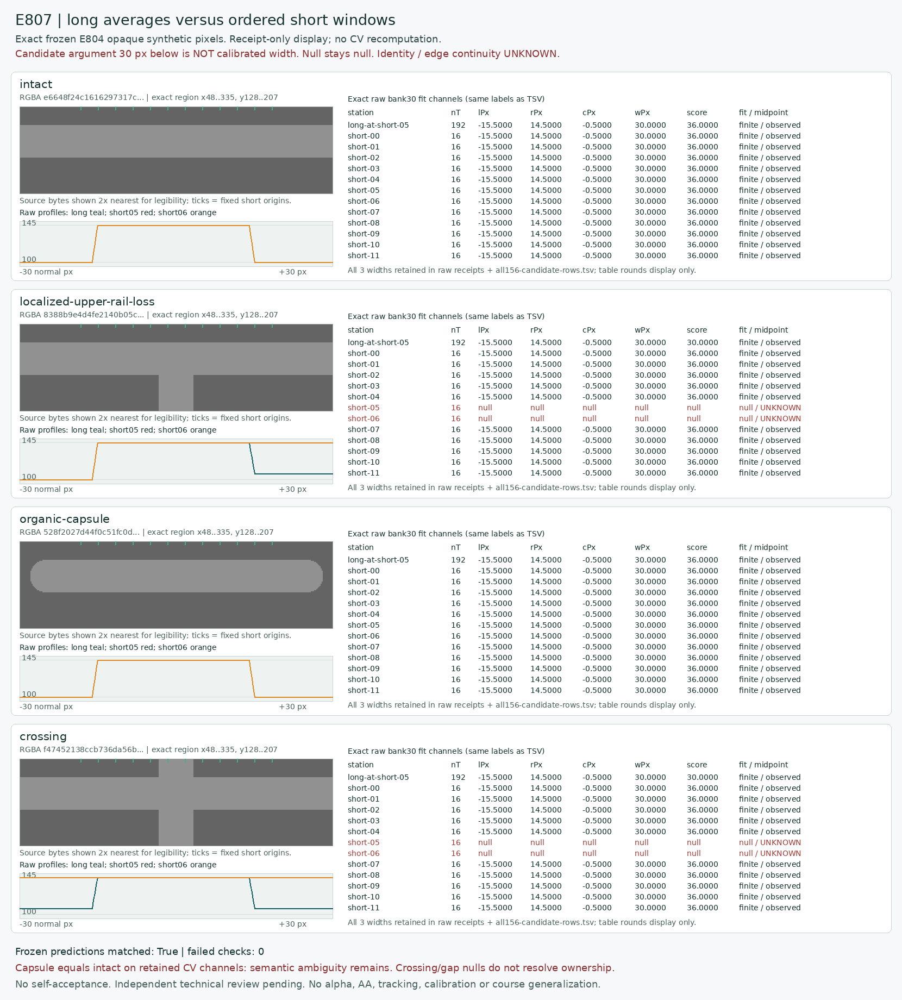
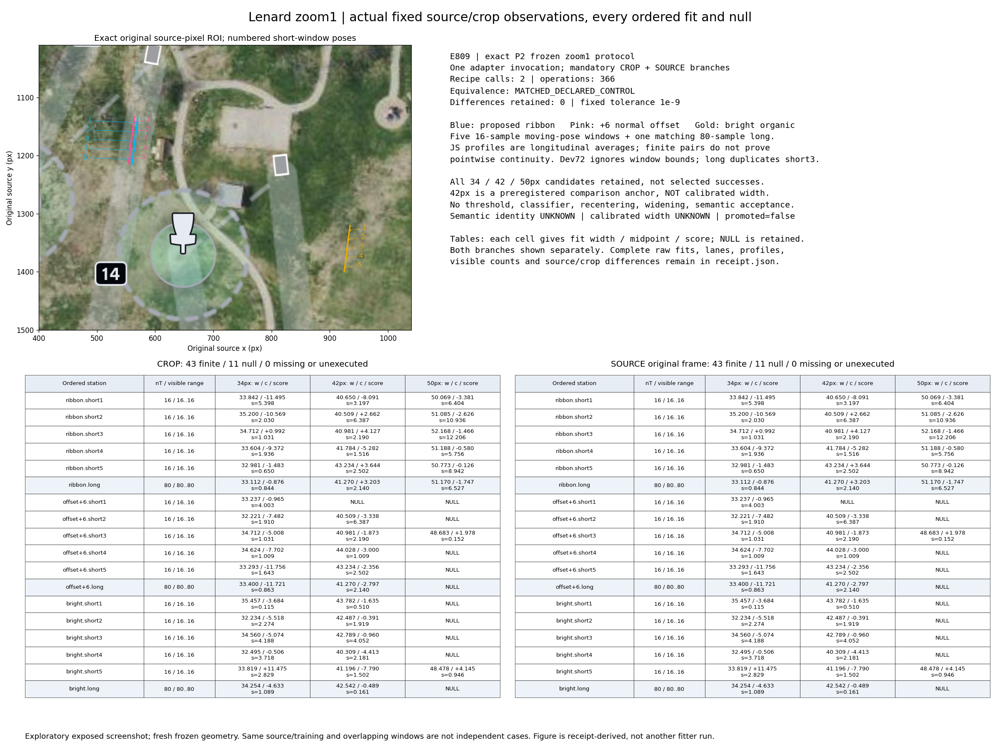
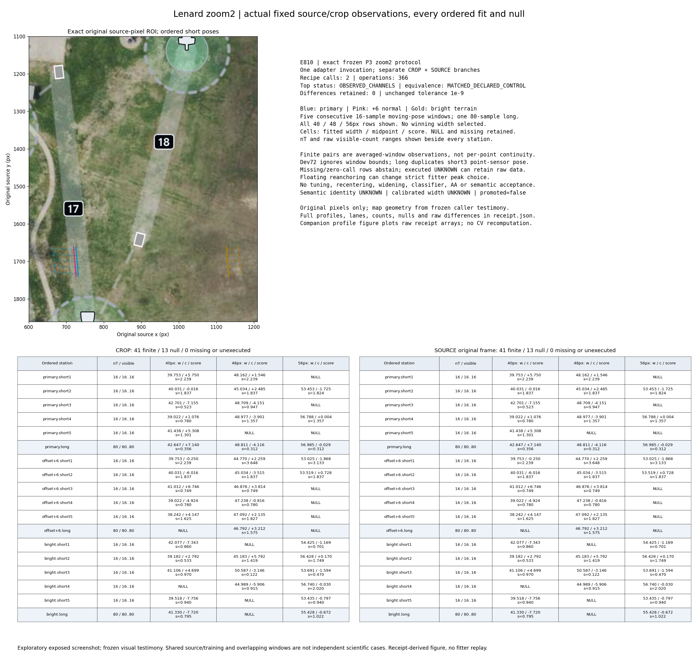
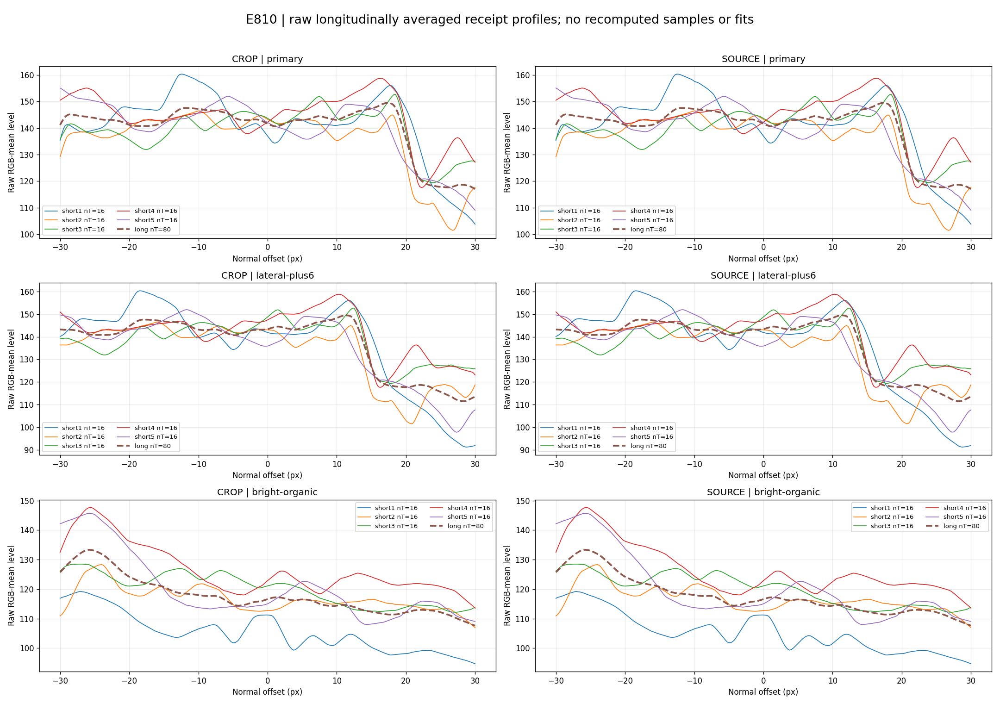

# Capability Discovery Lab — cycle04 ordered window evidence

The only reusable source addition is the standalone, default-OFF [receipt grouper](../../../experiments/capability-discovery/window-evidence/README.md). It hashes exact receipt bytes and exposes caller-declared long/ordered-short raw station objects in both existing branches. It adds no CV, score, coordinates, runner, ABFeature or production wiring. Exact [E813 source freeze](capture/P6/E813/source-freeze.json) was independently accepted by [R813](capture/P1/R813/result.json); source SHA256 is `c8abdc46721e01df64f8ae81318582ee3d639104389c9f5a43b539ef3fbf5e83`. Accepted d31b source pixels and5b59 composition remain unchanged. Byte/shape validation is not authenticated execution or scientific acceptance; raw objects and supplied bytes are aliases, as documented by the helper.

| Fixed evidence | Retained result | What it does not establish |
| --- | --- | --- |
| E807 synthetic / R807 replay | Four unchanged composition calls,156 candidate rows,94 predeclared comparisons matched. Bank30 long fits coexist with two fixed short nulls; capsule channels equal intact. | Continuous physical edges, semantic discrimination or independent course data. |
| E809 Lenard-1 / R809 replay | One adapter/two recipes;43 finite and11 null rows per branch. At42 all five primary shorts and long fit, but all bright controls also fit. Shifted short1 null and short4 residual−8.282100436166711px retain failed universal+6 association. | Same-edge identity, width calibration or bright-structure specificity. |
| E810 Lenard-2 / R810 replay | One adapter/two recipes;41 finite and13 null rows per branch. Primary48/56 long fits coexist with short nulls; bright56 all five shorts and long fit. | Physical absence from nulls, per-position continuity or path identity. |
| E811 / R811 runtime control | Both top statuses UNKNOWN. Supported empty-bank A executes two recipes/profiles with candidates[]; preparation-refusal B executes zero and has no branches. Raw native entry ranges include explicit zeros. | A scientific path result; UNKNOWN alone cannot classify execution. |

All full authoritative receipts are retained in `capture`; byte-identical reviewer copies use exact capture-index aliases, not recomputation. Source/crop controls for both actual zooms match the unchanged1e-9 comparison for these declarations only; historical crop/rounding/strict-fit seams remain valid counterexamples to general invariance. Every width, fit/null, profile/count, lane and equivalence difference remains raw evidence. nT<8 cannot meet the existing fitter guard. Identical-pose Dev72 rows ignore window bounds and are duplicate local observations.

The original E807 figure footer says independent review pending, which was true when rendered. Current accepted R807 is a separate later record; the figure bytes are not rewritten.

The two zooms are exposed caller-selected views of the same course, not heldout or independent-course evaluation. Original geometry, sample phases, masks and nominal widths were frozen before measurement; independent engineering replay is not another scientific case. No calibrated width, scale, AA/renderer identity, endpoint ownership, path acceptance or default-ON behavior follows; promoted=false.

History is not flattened. R806 AMEND led to narrowed E808: executed UNKNOWN versus zero-call refusal and one invalid-input policy. Original E812 red1 is tool-transcript testimony; red2 captured stdout is exact. R812 AMEND found sparse short-ID holes; original red regressions precede the minimal E813 own-index repair. [History-copy erratum](administration/history-copy-erratum.json) qualifies old archive-check claims: the authoritative R812 counterexample is50,209 bytes, while a35,295-byte truncated scratch copy was quarantined only during E899. Both identities and the invalid partial are explicit; frozen E813/R813 are not rewritten.

E809 retains its missing `/usr/bin/time` pre-CV launch failure, original bad-layout figure, refused-overwrite renderer traceback and separate display-v2 correction; no CV rerun repaired a figure. E810 retains the original resource boilerplate and separate clarification that no external time utility/log existed. Native epoch11 score rejection and the coordinator's rejected premature start are distinguished from the policy-narrowed successful re-solve. The start error has tool-transcript testimony only; no missing raw log is invented. No allocator-quality, optimality, speedup or matched-baseline advantage is claimed.

Engineering gates are17 focused/130 Lab/2 staging passing. The full repository is not green: repaired187-test TAP has170 pass/17 fail; exact untouched-base170-test TAP has153 pass/the same17 named failures. The earlier incomplete default-reporter baseline is not count authority. Original failures and immutable old histories remain unchanged; new archival `.mjs.txt` storage prevents historical/red sources from becoming new active tests, without hiding any active failure.

[REPRODUCE.md](REPRODUCE.md) describes exact-name scratch restoration, separately hashed path-only companions, omitted-pixel reconstruction and read-only package verification. No producer/CV is run by default. [RESUME.md](RESUME.md) and [next-packets.json](next-packets.json) preserve the separate package-audit/commit/publication gates and one guarded, unexecuted station-contrast proposal. Captured native state is historical: E899/P6 is running, R813 done and R899 pending. The separately later [pool status](administration/later-pool-status.json) supersedes its capacity description at that capture: only P6 ran; P1/P4/P5 were completed contexts, six worker slots possible/four Lab entries registered. The still-later [audit registration](administration/audit-registration.json) records fresh independent V1 for planned R899 instead of P5; registration is not native audit start, which root admits only after package readiness. The interim Lab4+HH2 occupancy was true historically, not a current capacity blocker. No filler/scientific packet is created to use spare slots. Root alone owns live allocator and connected publication; P6 alone owns source/Git integration. No HH source or Lab PR, merge, commit or publication is included.
